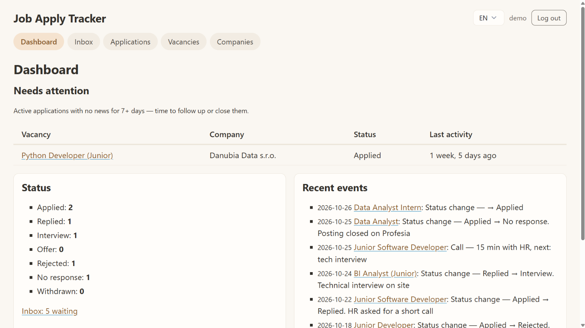
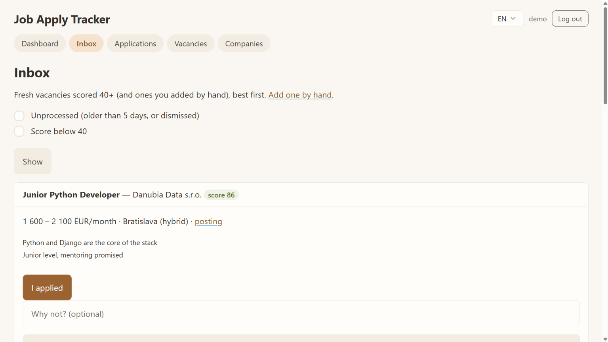
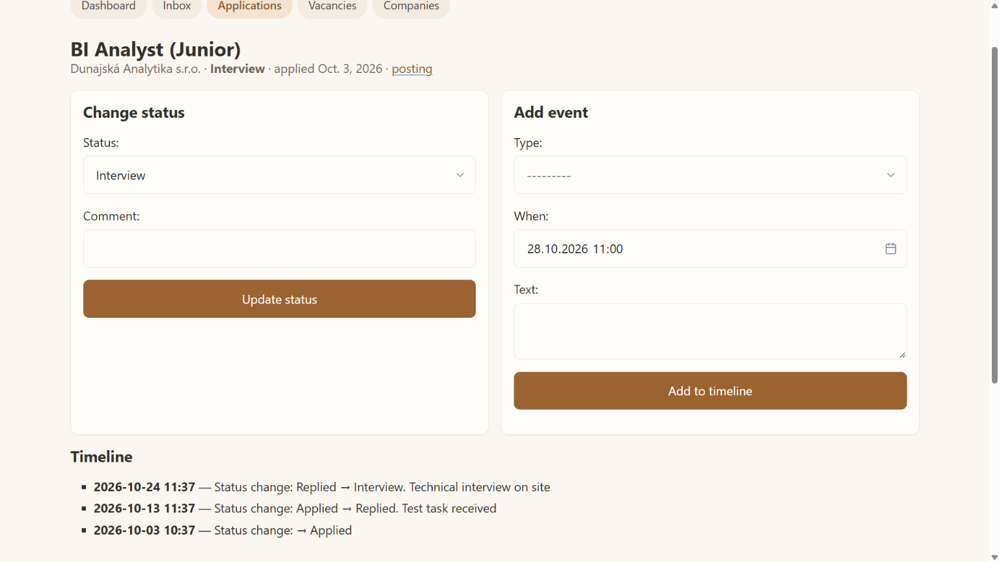
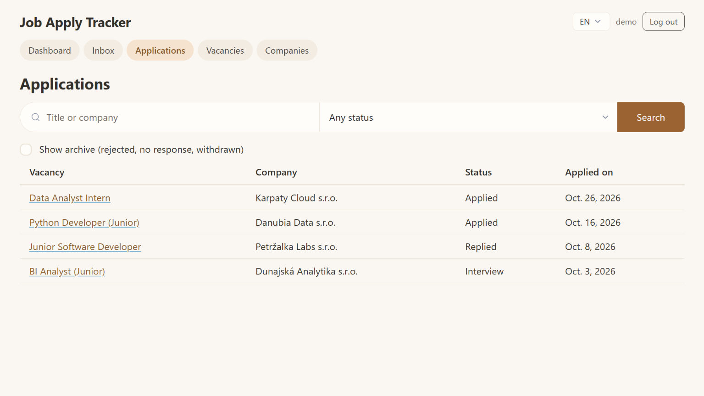
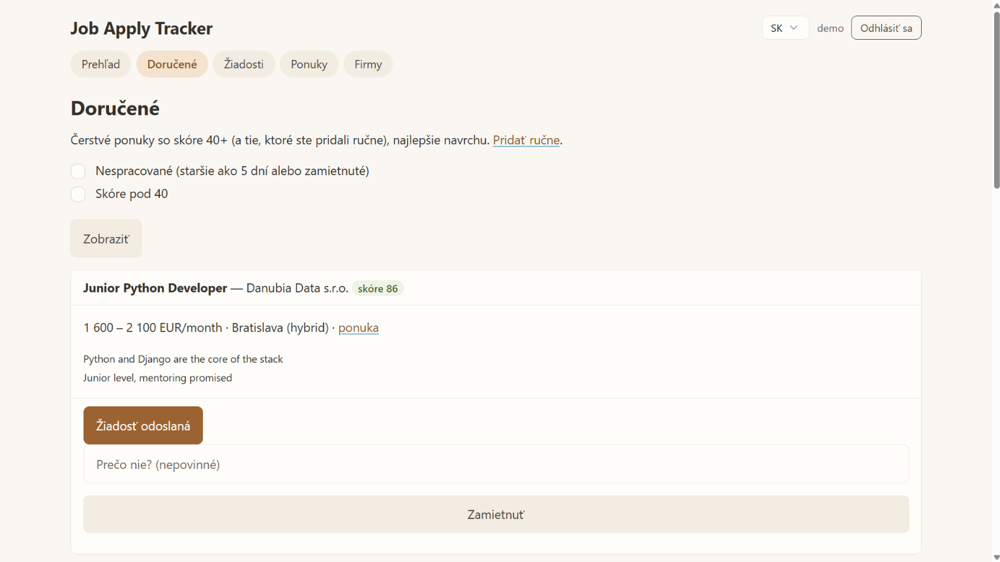

# Job Apply Tracker

[English version](README.md)

**Job Apply Tracker** — мой личный трекер поиска работы на Django, пользуюсь им каждый день.
Другой мой проект, [job-ai-assist](https://github.com/OleksiiShcherbynin/job-ai-assist), собирает
вакансии с Profesia.sk и оценивает каждую с помощью LLM; подходящие попадают сюда автоматически.
Здесь я с ними работаю: откликаюсь, отклоняю, слежу за статусами и историей каждой заявки. Ничего не
теряется: заявки без движения поднимаются на главный экран, а объявления, закрытые на Profesia,
закрываются сами.



| Входящие: оценённые вакансии, лучшие сверху | Одна заявка и её история |
|---|---|
|  |  |
| **Все заявки, с поиском и архивом** | **Те же входящие по-словацки** |
|  |  |

На скриншотах демо-аккаунт; все компании и вакансии в нём выдуманные.

## Что показывает код

- **Изоляция данных пользователей** — каждая строка принадлежит пользователю; запросы фильтруются по
  владельцу, чужой объект — это 404, а не 403.
- **Свои QuerySet и фиксированный бюджет запросов** — «требует внимания» и виды входящих считаются
  аннотациями и подзапросами; тесты закрепляют число SQL-запросов на страницу, поэтому N+1 не пролезет.
- **API с токеном для другой программы** — Django REST Framework, токены, всё закрыто по умолчанию,
  схема OpenAPI; пачка вакансий получает результат по каждой, а не «всё или ничего».
- **Идемпотентный приём** — повторно присланная вакансия обновляется, а не дублируется; переопубликация
  той же работы под новым номером узнаётся и связывается с прежней заявкой.
- **Правила домена вне views** — что значит закрытое объявление (молчание → «Нет ответа», входящие →
  отклонено), описано обычным Python-кодом (`tracker/closing.py`), API только проверяет и перебирает.
- **Нормальная i18n** — английский, словацкий и русский; язык берётся только из переключателя;
  тексты, которые пишет код, хранятся в базе по-английски и переводятся при показе.
- **Тесты и CI** — pytest + factory_boy на настоящем PostgreSQL, покрытие ~99% при пороге 85%;
  GitHub Actions запускают ruff, тесты, bandit, pip-audit и gitleaks по всей истории.
- **Docker** — Postgres + gunicorn (воркеры gthread) + WhiteNoise, миграции при старте, загруженные
  файлы отдаются только владельцу.

Все решения и их причины: [docs/architecture.ru.md](docs/architecture.ru.md).

## Как запустить у себя

Нужен Docker.

```bash
cp .env.example .env            # локальные настройки; для пробы подходят как есть
docker compose up -d --build    # Postgres + приложение на http://localhost:8000
docker compose exec web python manage.py seed_demo
```

Откройте http://localhost:8000 и войдите как **demo** / **tracker-demo**. Переключатель языка —
в правом верхнем углу.

`seed_demo` можно запускать снова в любой момент: команда пересоздаёт данные демо-аккаунта и больше
ничего не трогает.

## Технологии

Python 3.12 · Django 5.2 · Django REST Framework · drf-spectacular · PostgreSQL 17 · Pico.css ·
pytest-django · factory_boy · Docker Compose · GitHub Actions
