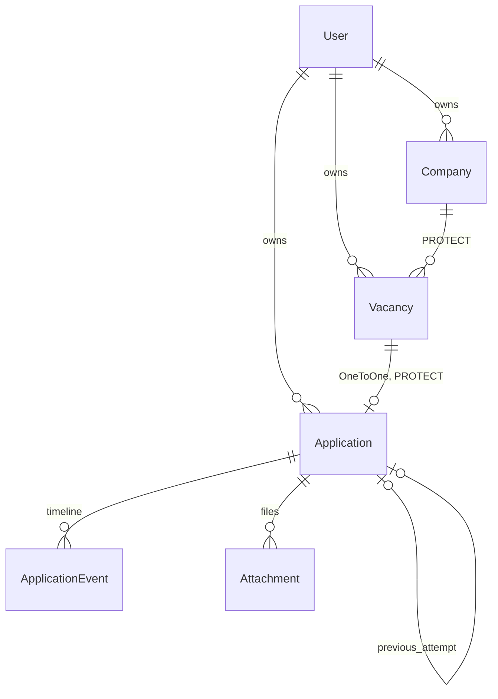

# Architecture

How job-apply-tracker is actually built as of `v1.0.0` (Stage 0, MVP, Stage 2 Part A — the
tracker side of the job-ai-assist push, Stage 3 Part A — the tracker side of auto-close, Stage 4 —
English/Slovak/Russian UI, the warm theme and the demo account).
What it should become is in the [design spec](superpowers/specs/2026-10-14-job-apply-tracker-design.md);
this document describes the code that exists. Russian translation: [architecture.ru.md](architecture.ru.md).

## Apps

| App | Owns |
|---|---|
| `config/` | settings (`base` / `dev` / `prod`), root URLs, WSGI/ASGI |
| `accounts/` | custom `User` with per-user settings: `follow_up_days` (7), `inbox_min_score` (40), `inbox_fresh_days` (5) |
| `tracker/` | the whole domain: models, querysets, forms, views, templates, ingest and closing rules |
| `api/` | HTTP only: DRF serializers and views; the rules live in `tracker/ingest.py` and `tracker/closing.py` |

Plain layered Django on purpose — fat models and querysets, thin views.

## Data model

- **Vacancy** lives in `inbox` until the user acts on it: `applied` or `dismissed` (with a reason).
  `external_id` (Profesia offer id) is unique per owner when present — the hook for idempotent pushes in Stage 2.
- **Application** exists only once the user really applied; one per vacancy.
  Status: `applied → replied → interview → offer / rejected / no_response / withdrawn`.
- **ApplicationEvent** is the timeline. A status change always writes a `status_change` event.
- **Attachment** — the file that was actually sent (CV version, cover letter).
- Every model has `created_at` / `updated_at` (`TimeStampedModel`).
- **Vacancy.fingerprint** — `company|title`, lowercased, accents stripped, whitespace collapsed; the
  same rule job-ai-assist uses, stored and indexed. Same fingerprint, different offer id = a repost.
- **Vacancy.first_seen_at** — when job-ai-assist first saw the offer; a vacancy's age counts from it
  (falls back to `created_at`). Plus `score_stage` (`rough` / `final`) and Russian reasons.
- **Vacancy.closed_at** — when job-ai-assist reported the Profesia posting closed; shown as
  "Closed on Profesia (DATE)" on inbox cards and the application page.
- A hand-entered vacancy with a Profesia link gets `external_id` from it (`…/O1234567`, see
  `tracker/profesia.py`) on a full save, unless another of the owner's vacancies holds that id.

## A request, end to end

1. **Middleware** loads the session, sets `request.user`, checks the CSRF token on every POST.
2. **URLs** (`config/urls.py` → `tracker/urls.py`, namespace `tracker`) pick a class-based view.
3. **View** gets data through an owner-filtered queryset, renders a template that extends `templates/base.html`.
4. Every state change is a **POST** and ends in a **redirect** (POST/redirect/GET). Invalid forms re-render
   the same page with errors next to the field.

## Owner isolation

Multi-user from day one, no open registration (accounts are created by admin or `createsuperuser`).

- `OwnerQuerySetMixin` (`tracker/mixins.py`) filters every view's queryset by `owner=request.user`
  and requires login. Detail/update/delete views look objects up *inside* that queryset, so another
  user's pk is simply not found → **404**.
- `OwnedModelForm` receives `owner` from the view (`OwnerFormMixin`) and sets `instance.owner`.
  `owner` is never a form field, so the user cannot pick it — and so Django skips `(owner, …)`
  constraints during form validation. Owner-aware checks therefore live in the form:
  `CompanyForm.clean_name` (case-insensitive duplicate), `VacancyForm` limits the company dropdown
  to the owner's companies (a tampered foreign id fails validation).
- Child rows (`ApplicationEvent`, `Attachment`) inherit ownership through `application`.
- Uploaded files are private: no public `/media/` route; `attachment_download` serves a file only
  to its owner.

## Key flows

- **"I applied"** — `Vacancy.mark_applied()` creates the Application, its first `status_change` event
  and flips the vacancy to `applied` in one transaction; an optional file becomes an Attachment in the
  same transaction. The first event is dated on the entered `applied_at`, so an application entered
  late still ages correctly. A second "I applied" redirects to the existing application.
- **Status change** — `Application.change_status()` updates the status and writes the event in one
  transaction. "Changing" to the current status is a form error.
- **Needs attention** — `ApplicationQuerySet.needs_attention(owner)`: active statuses (`applied`,
  `replied`) whose latest event is older than `owner.follow_up_days`; applications with no events
  fall back to `applied_at`. Computed with `annotate(Max(...))`, nothing stored.

## Ingest API (Stage 2)

`POST /api/v1/vacancies/`, token authentication only (`create_api_token <username>` issues a key),
throttled, OpenAPI schema at `/api/schema/` with Swagger UI. Contract and rules:
[Stage 2 spec](superpowers/specs/2026-10-24-stage2-push-api-design.md).

- Batches of up to 200; the answer is per item (`created` / `updated` / `invalid`), so one bad record
  never blocks the rest.
- `tracker.ingest.ingest_vacancy()` is the only write path: a known `external_id` refreshes only what
  job-ai-assist owns (title, url, salary, location, score, reasons) and never the state, the dismissal,
  the company link or the application; a hand-entered vacancy with the same fingerprint is
  **adopted** (gets the offer id) instead of duplicated; companies match ignoring case and spaces.

## Auto-close API (Stage 3)

job-ai-assist checks the author's Profesia offers once a day and reports the closed ones. Contract:
[Stage 3 spec](superpowers/specs/2026-10-26-auto-close-design.md). Same token and throttle as ingest.

- `GET /api/v1/vacancies/to-check/` → `{"vacancies": [{"external_id", "url"}]}` from
  `VacancyQuerySet.to_check(owner)`: has an offer id, not closed yet, and either an application at
  Applied or an undecided inbox vacancy scored ≥ `inbox_min_score` (or unscored). One query.
- `POST /api/v1/vacancies/closed/` with `{"closed": [{"external_id", "seen_at"}]}` (≤ 200) → per item
  `closed` / `unchanged` / `unknown` / `invalid`. `tracker.closing.report_closed()` applies one report
  in a transaction with the vacancy row locked:
  Applied → No response (`change_status`, event dated `seen_at`); any other status → a `note` event
  only; inbox → dismissed "Closed on Profesia"; already dismissed → just `closed_at`. Already closed
  → `unchanged`.

## Inbox views (Stage 2)

`VacancyQuerySet.for_inbox_view(owner, ...)` puts every not-applied vacancy in exactly one view:

- **default** — in the inbox, score ≥ `inbox_min_score` or unscored, younger than
  `inbox_fresh_days`, and the newest undecided one of its fingerprint;
- **Unprocessed** toggle — same score rule, but old, superseded by a newer repost, or dismissed
  (with "Back to inbox");
- **Score below …** toggle — under the threshold, in the inbox or dismissed.

Cards carry repost markers ("Already applied on DATE — STATUS", "Dismissed before"), all computed
with `Exists` / `Subquery` annotations in the same query. Applying again to a repost needs an
explicit confirmation and links the new application to the earlier one.

The applications list hides closed statuses (Rejected, No response, Withdrawn) unless the
**Archive** toggle or an explicit status filter is used.

## Deployment on the laptop (Stage 2)

- `docker compose up -d` runs `db` (Postgres 17) and `web` (gunicorn, WhiteNoise, private media in a
  named volume), both `restart: unless-stopped`. The browser opens http://localhost:8000.
- `web` owns the live database `tracker`; development and tests use `tracker_dev` on the same server,
  so a feature branch never touches live data.
- The container runs `migrate` on start, so the live container is rebuilt **only from `main`**:
  `docker compose up -d --build web`.
- `web` joins the fixed-name network `job-net` as `job-apply-tracker`; job-ai-assist declares the same
  network and posts to `http://job-apply-tracker:8000/api/v1/vacancies/`.

## Languages and look (Stage 4)

- UI in English (default), Slovak and Russian. `config.locale.CookieLocaleMiddleware` activates the
  language from the cookie written by Django's `set_language` (the header dropdown) and ignores the
  browser's `Accept-Language`, so every visitor starts in English.
- Strings are marked with `` / `gettext_lazy`; catalogs live in `locale/` and are
  committed as `.po` **and** compiled `.mo`, because the dev machine has no GNU gettext.
  `docker/i18n.sh` regenerates and compiles them in a throwaway `python:3.12-slim` container; the
  project's `makemessages` turns off fuzzy matching. `tests/test_translations.py` fails when a string
  is untranslated or the `.mo` is stale.
- Texts the code stores (`"Applied → Rejected. <comment>"`, `"→ Applied"`, "Posting closed on
  Profesia", "Closed on Profesia") are always written in English and translated at display time by
  the `system_text` filter; anything a person typed is shown as stored. Score reasons follow the
  language (`reasons` filter: Russian UI → Russian reasons first).
- The look is `static/css/theme.css` over Pico.css: light only, warm sand palette, two-row header
  (name + language/user/log out, then the five sections as pills with the current one highlighted).

## Demo account (Stage 4)

`python manage.py seed_demo` (re)creates the user `demo` / `tracker-demo` with invented Bratislava
companies, scored vacancies, applications in every status and one posting closed on Profesia; dates
are relative to the day it runs. It only ever touches the demo user's rows and refuses to run when a
`demo` account is staff, a superuser or has an API token. In the live container:
`docker compose exec web python manage.py seed_demo`.

## Query budget

Every list and the dashboard have a fixed number of queries regardless of data size, pinned by
`django_assert_num_queries` tests: `select_related` for the "one" side (vacancy → company),
`prefetch_related` for the "many" side (application → events, attachments, later attempts).
Inbox markers and the "newer repost" flag are subqueries inside the inbox query.

| Page | Queries |
|---|---|
| companies, inbox, vacancies, applications | 3 |
| application detail | 6 |
| dashboard | 6 |

(Two of them are always the session and the user.)

## Testing and CI

pytest-django + factory_boy, real PostgreSQL in tests, coverage gate 85% (currently ~99%).
GitHub Actions: ruff (lint + format), tests with coverage, bandit, pip-audit, gitleaks over full history.

## Decisions

One entry per decision: context → decision → consequence.

1. **Layered Django, not ports & adapters.** The goal is idiomatic Django; admin, forms and the ORM
   are built around models. → Logic lives in model methods and querysets, views stay thin.
2. **Custom `User` before the first migration.** Swapping the user model later means rewriting FKs
   in every table. → `accounts.User` from commit one, carrying per-user settings.
3. **Computed "needs attention", not a stored `last_activity`.** A denormalized field can drift from
   the timeline. → One `annotate(Max)` query; revisit only if it gets slow.
4. **Model methods, not signals, for multi-step writes.** Signals hide side effects. →
   `mark_applied()` and `change_status()` are the only entry points and run in `transaction.atomic()`.
5. **Owner-aware validation in forms.** Owner is not a form field, so DB constraints on
   `(owner, …)` are not checked by the form and a duplicate would surface as a 500. →
   `OwnedModelForm` + `clean_<field>`; the DB constraint stays as the safety net.
6. **`PROTECT` on company → vacancy → application, with friendly errors.** Deleting a company must not
   silently erase applications and their history. → Deleting a company with vacancies shows a message;
   deleting a vacancy with an application is allowed only after an explicit tick on the confirm page,
   which names what goes with it (application, timeline, stored files).
7. **First event dated on `applied_at`.** Otherwise an application entered a few days late looks fresh
   and drops out of needs attention.
8. **One application per vacancy; double "I applied" redirects.** Matches reality, keeps forms simple;
   a re-application months later is a new vacancy.
9. **`status_change` events only through `change_status`.** The event-type dropdown excludes it, and a
   no-op change is rejected, so status and timeline cannot disagree and the follow-up clock is not
   reset by accident.
10. **Private attachments.** CVs are personal data. → No public media route even in DEBUG; files are
    served by an owner-checked view. Stage 4 only has to keep `media/` off the web server's static paths.
11. **Upload checks: extension + 5 MB, not file content.** Each user uploads into their own tracker and
    gets files back only as their owner. Default label = file name, cut to 100 characters.
12. **Ownership of child rows via `application`.** Spec says every model has an owner; events and
    attachments get it through their application — one source of truth.
13. **Application page = one detail view + three small POST-only views** sharing `ApplicationPageMixin`.
    Invalid input re-renders the page with the error next to its field instead of a flash message.
14. **Site-wide templates in `templates/`** (`base.html`, `registration/login.html`); app pages in
    `tracker/templates/tracker/`. Logout is POST-only and redirects to login.
15. **Environment pins.** `psycopg[binary]==3.2.9` (newer Windows wheels are blocked by Smart App Control
    on the dev machine); compose Postgres on host port **5433** (5432 is taken by a local PostgreSQL).
16. **Deferred, then settled:** security headers / HTTPS live in `prod.py` behind `DJANGO_HTTPS`;
    Stage 4 dropped the public deployment (no hosting budget), so they stay unused on the laptop.
    Still deferred: pagination (not needed at one user's volume), UI for editing notes or deleting events/attachments (admin covers it), cleaning up
    files of deleted attachments.
17. **Ingest rules in the domain, HTTP in `api/`.** The same rules could serve a CSV import or a
    management command later. → `tracker/ingest.py` is plain Python; the view only validates and loops.
18. **Per-item ingest results, not all-or-nothing.** One malformed vacancy must not jam the sender's
    retry queue forever. → `200` with `created` / `updated` / `invalid` per item; only a malformed body
    is `400`.
19. **Pushes never overwrite the author's decisions.** Re-pushes refresh job-ai-assist's fields only;
    hand-entered vacancies are adopted, not duplicated.
20. **Token-only API, deny by default.** `REST_FRAMEWORK` defaults to token authentication and
    `IsAuthenticated`; only the schema views opt out. No CSRF on the API: tokens are not sent
    automatically by browsers.
21. **Inbox views computed, never stored.** Age, "newer repost" and repost markers are annotations;
    a test proves the three views partition all not-applied vacancies.
22. **Dismiss / Back-to-inbox only from the right state.** Dismiss accepts only inbox vacancies,
    Back-to-inbox only dismissed ones (otherwise 404), so a stale tab cannot dismiss an applied vacancy.
23. **Live vs dev data, and how the container is built.** Separate databases; `STATIC_ROOT` only in
    prod settings; `.gitattributes` keeps `*.sh` LF so the entrypoint survives Windows checkouts; the
    local `.env` (secret key) is generated by a script that never prints it.
24. **Fingerprint gets a default.** `fingerprint` has `default=""` so migrations run non-interactively;
    `save()` always sets it and a data migration backfilled existing rows.
25. **Closure rules in the domain, fetching outside the tracker.** The tracker never visits Profesia;
    job-ai-assist reports, `tracker/closing.py` decides what a closure means — like ingest (17).
26. **A closed posting without an answer is silence.** Applied → No response even if the company
    reposted the vacancy under a new id (the author's call); the repost stays in the inbox with its
    "Already applied" marker. Statuses where the company already answered never change.
27. **Offer id from the link, never stolen.** Filled only on full saves (form saves) so status changes
    and renames stay one query, and only when no other vacancy of the owner has the id; migration 0009
    did the same once for existing rows. Such a vacancy is then "known" to ingest, so later pushes
    refresh its Profesia fields instead of adopting it.
28. **`closed_at` is a fact, not a state.** "Back to inbox" keeps it, so a restored closed vacancy is
    not offered for checking again and the closure is never reported twice.
29. **Language from the switch only.** `LocaleMiddleware` would follow `Accept-Language`, so an
    interviewer with a Slovak browser and every screenshot would land on a random language. → A small
    cookie-only middleware; garbage or unsupported cookies fall back to English.
30. **System texts translated at display time, not stored per language.** The timeline already holds
    English texts on live data. Storing structured events ("from X to Y") was rejected: it needs a
    migration of the author's live rows for little gain. → The code keeps writing English
    (`translation.override("en")`), `system_text` recognises only the exact shapes the code writes.
31. **Compiled catalogs in the repo.** No gettext on the dev machine and no new dependency. → `.po` +
    `.mo` committed, regenerated in a container, guarded by a test that compares them; no plural forms
    (counts read "Files: 3"), gender-neutral wording ("Отклик отправлен").
32. **Demo data in the live database, behind a guard.** The author shows the tracker from his laptop
    without exposing real applications: log out, log in as `demo`. Owner isolation keeps the rows
    apart; the guard keeps a real "demo" account from being taken over.
33. **No public deployment.** Free hosting was declined; the README with screenshots is the showcase
    and `docker compose up` + `seed_demo` runs it locally. Theme colours are a shade darker than the
    mockup where needed for WCAG AA contrast.
