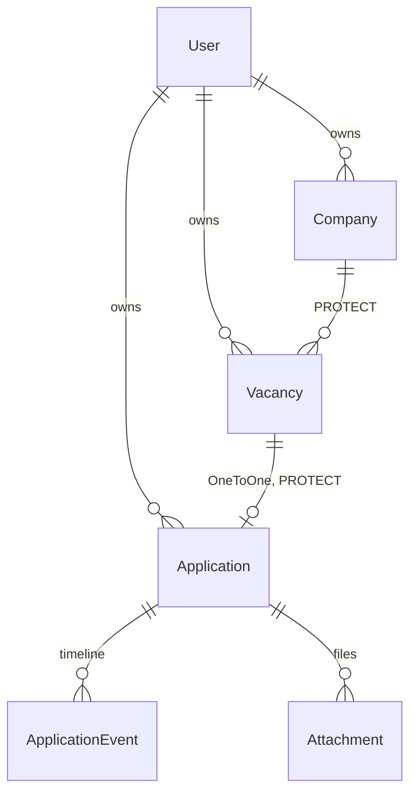

# Архитектура

Как job-apply-tracker устроен на самом деле на момент `v0.1.0` (этап 0 + MVP).
Каким он должен стать — в [дизайн-спеке](superpowers/specs/2026-10-14-job-apply-tracker-design.ru.md);
здесь описан код, который уже есть. Это перевод [architecture.md](architecture.md); при расхождениях
главный английский файл.

## Приложения

| Приложение | Отвечает за |
|---|---|
| `config/` | настройки (`base` / `dev` / `prod`), корневые URL, WSGI/ASGI |
| `accounts/` | кастомный `User` (добавляет `follow_up_days`, по умолчанию 7) |
| `tracker/` | весь домен: модели, querysets, формы, views, шаблоны |

Обычный слоёный Django — сознательно: «толстые» модели и querysets, «тонкие» views. На этапе 2
появится приложение `api/` (DRF).

## Модель данных

- **Vacancy** лежит во `inbox`, пока пользователь не решил: `applied` или `dismissed` (с причиной).
  `external_id` (ID оффера Profesia) уникален в пределах владельца, если задан, — задел для
  идемпотентных пушей на этапе 2.
- **Application** появляется, только когда пользователь реально откликнулся; один на вакансию.
  Статусы: `applied → replied → interview → offer / rejected / no_response / withdrawn`.
- **ApplicationEvent** — лента событий. Смена статуса всегда пишет событие `status_change`.
- **Attachment** — файл, который реально отправили (версия CV, сопроводительное письмо).
- У каждой модели есть `created_at` / `updated_at` (`TimeStampedModel`).

## Путь запроса

1. **Middleware** загружает сессию, кладёт `request.user`, проверяет CSRF-токен у каждого POST.
2. **URL** (`config/urls.py` → `tracker/urls.py`, неймспейс `tracker`) выбирают class-based view.
3. **View** берёт данные через queryset, отфильтрованный по владельцу, и рисует шаблон,
   наследующий `templates/base.html`.
4. Любое изменение данных — **POST** и в конце **редирект** (POST/redirect/GET). Невалидная форма
   показывает ту же страницу с ошибкой рядом с полем.

## Изоляция данных пользователей

Multi-user с первого дня, без открытой регистрации (аккаунты создаются через админку или
`createsuperuser`).

- `OwnerQuerySetMixin` (`tracker/mixins.py`) фильтрует queryset каждой view по `owner=request.user`
  и требует входа. Detail/update/delete ищут объект *внутри* этого queryset, поэтому чужой pk просто
  не находится → **404**.
- `OwnedModelForm` получает `owner` от view (`OwnerFormMixin`) и ставит `instance.owner`. `owner`
  никогда не поле формы — пользователь не может его выбрать, — и поэтому Django пропускает
  ограничения `(owner, …)` при проверке формы. Отсюда проверки с учётом владельца живут в форме:
  `CompanyForm.clean_name` (дубль без учёта регистра), `VacancyForm` сужает выпадающий список компаний
  до компаний владельца (подменённый чужой id не проходит проверку).
- Дочерние записи (`ApplicationEvent`, `Attachment`) наследуют владельца через `application`.
- Загруженные файлы приватны: публичного маршрута `/media/` нет; `attachment_download` отдаёт файл
  только владельцу.

## Ключевые сценарии

- **«I applied»** — `Vacancy.mark_applied()` в одной транзакции создаёт Application, его первое событие
  `status_change` и переводит вакансию в `applied`; необязательный файл становится Attachment в той же
  транзакции. Первое событие датируется введённым `applied_at`, поэтому отклик, занесённый с опозданием,
  «стареет» правильно. Повторное «I applied» ведёт на существующий отклик.
- **Смена статуса** — `Application.change_status()` в одной транзакции меняет статус и пишет событие.
  «Смена» на текущий статус — ошибка формы.
- **Требует действия** — `ApplicationQuerySet.needs_attention(owner)`: активные статусы (`applied`,
  `replied`), у которых последнее событие старше `owner.follow_up_days`; у откликов без событий
  берётся `applied_at`. Считается через `annotate(Max(...))`, ничего не хранится.

## Бюджет запросов

На каждом списке и на дашборде число запросов к БД фиксировано и не зависит от объёма данных, это
закреплено тестами `django_assert_num_queries`: `select_related` для стороны «один» (вакансия →
компания), `prefetch_related` для стороны «много» (отклик → события, вложения).

| Страница | Запросов |
|---|---|
| компании, входящие, вакансии, отклики | 3 |
| страница отклика | 5 |
| дашборд | 6 |

(Два из них — всегда сессия и пользователь.)

## Тесты и CI

pytest-django + factory_boy, в тестах настоящий PostgreSQL, порог покрытия 85% (сейчас ~99%).
GitHub Actions: ruff (линт + форматирование), тесты с покрытием, bandit, pip-audit, gitleaks по всей
истории.

## Решения

Каждое решение: контекст → решение → следствие.

1. **Слоёный Django, не ports & adapters.** Цель — идиоматичный Django; админка, формы и ORM построены
   вокруг моделей. → Логика в методах моделей и querysets, views тонкие.
2. **Кастомный `User` до первой миграции.** Заменить модель пользователя позже — значит переписать FK
   во всех таблицах. → `accounts.User` с первого коммита, на нём настройки пользователя.
3. **«Требует действия» вычисляется, а не хранится `last_activity`.** Денормализованное поле может
   разойтись с лентой. → Один запрос с `annotate(Max)`; пересмотреть, только если станет медленно.
4. **Методы моделей, не сигналы, для многошаговых записей.** Сигналы прячут побочные эффекты. →
   `mark_applied()` и `change_status()` — единственные точки входа, работают в `transaction.atomic()`.
5. **Проверки с учётом владельца — в формах.** Owner не поле формы, поэтому ограничения БД на
   `(owner, …)` форма не проверяет, и дубль вылез бы как 500. → `OwnedModelForm` + `clean_<поле>`;
   ограничение в БД остаётся страховкой.
6. **`PROTECT` для компания → вакансия → отклик, с понятными ошибками.** Удаление компании не должно
   молча стереть отклики и их историю. → Views удаления ловят `ProtectedError` и показывают сообщение.
7. **Первое событие датируется `applied_at`.** Иначе отклик, занесённый на несколько дней позже,
   выглядит свежим и выпадает из «требует действия».
8. **Один отклик на вакансию; повторное «I applied» — редирект.** Соответствует реальности, упрощает
   формы; повторный отклик через месяцы — это новая вакансия.
9. **События `status_change` только через `change_status`.** В выпадающем списке типов события его нет,
   а «смена» на тот же статус отклоняется: статус и лента не могут разойтись, а таймер follow-up не
   сбрасывается случайно.
10. **Приватные вложения.** CV — личные данные. → Публичного маршрута для media нет даже в DEBUG; файлы
    отдаёт view с проверкой владельца. На этапе 4 нужно только не выставлять `media/` веб-сервером.
11. **Проверка загрузки: расширение + 5 МБ, без анализа содержимого.** Каждый загружает в свой трекер и
    получает файлы обратно только сам. Подпись по умолчанию — имя файла, обрезанное до 100 символов.
12. **Владелец дочерних записей — через `application`.** В спеке у каждой модели есть owner; события и
    вложения получают его через свой отклик — один источник правды.
13. **Страница отклика = одна detail view + три маленьких POST-only view** с общим
    `ApplicationPageMixin`. Ошибка ввода показывает страницу заново с ошибкой у поля, а не flash-сообщение.
14. **Общие шаблоны сайта в `templates/`** (`base.html`, `registration/login.html`); страницы приложения —
    в `tracker/templates/tracker/`. Logout только через POST и ведёт на страницу входа.
15. **Закрепления под окружение.** `psycopg[binary]==3.2.9` (более новые сборки под Windows блокирует
    Smart App Control на машине разработки); Postgres из compose на порту хоста **5433** (5432 занят
    локальным PostgreSQL).
16. **Отложено на следующие этапы:** заголовки безопасности / HTTPS (этап 4), пагинация (не нужна при
    объёме одного пользователя), UI для правки заметок и удаления событий/вложений (есть админка),
    уборка файлов удалённых вложений.
